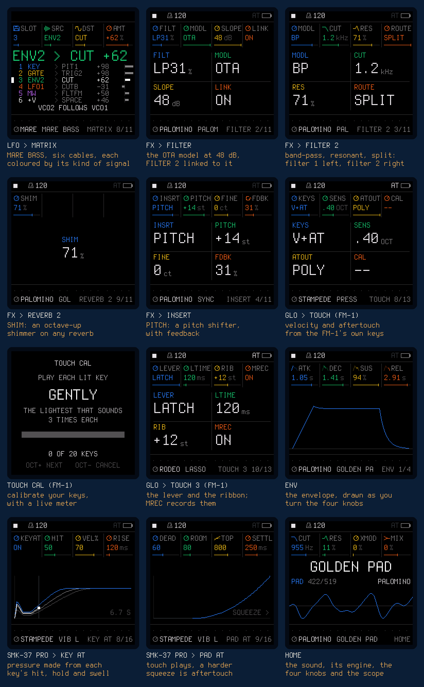
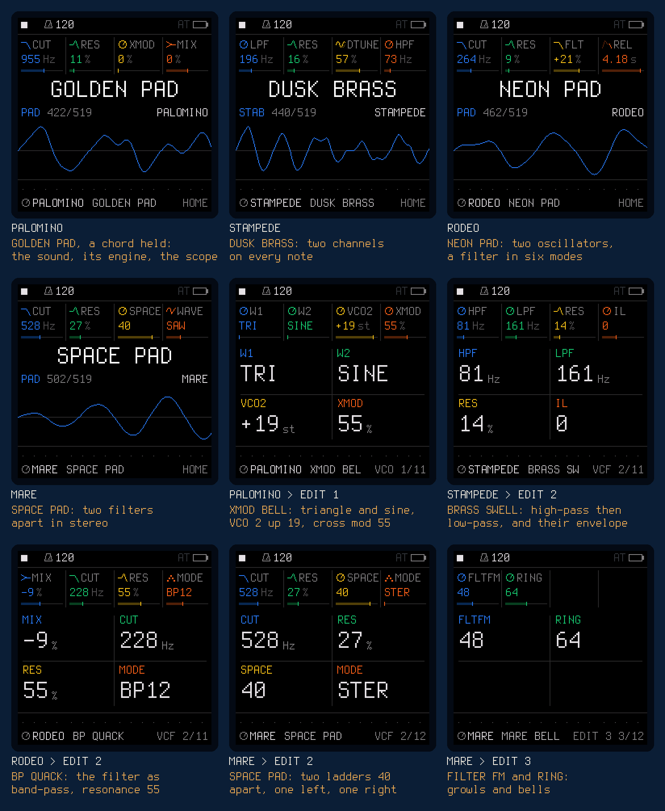

<picture><source media="(prefers-color-scheme: light)" srcset="assets/logo/stallion-logo-light.png"></picture>

# Stallion 1.0: the guide

Stallion is free, open-source synthesizer firmware for the **M-VAVE FM-1** and the **M-VAVE SMK-37 Pro**, by Eberon Limited (John Gorman). This guide takes you from installing it to patching the matrix. Read it from the top the first time; after that, the [contents](#contents) and the [cheat sheet](#14-cheat-sheet) take you straight to what you need.

The site, with both installers and the editor: **[eberonltd.github.io/stallion-fm1](https://eberonltd.github.io/stallion-fm1/)**. Everything Stallion 1.0 adds to Clipper, item by item: the site's [What's new in 1.0](https://eberonltd.github.io/stallion-fm1/whats-new.html) page, the README's [New features in Stallion](README.md#new-features-in-stallion) and the release notes, [docs/stallion-1.0.0.md](docs/stallion-1.0.0.md).

---

## How to read this guide

| Written | Means |
| --- | --- |
| **tap FX** | press FX and let go, without touching anything else |
| **hold FX** | keep FX pressed |
| **FX + key 3** | hold FX, and while it is held press white key 3 |
| **GLO > MIDI 3** | tap GLO, then turn SELECT (or tap GLO again) until the page called MIDI 3 |
| **MENU** | hold HOME: the menu of settings |
| **KNOB 1 … KNOB 4** | the four knobs under the screen; each one sets the value shown above it, in the same colour |
| **key 1 … key 16** | the 16 white keys, from the lowest (F3) to the highest (G5) |

The FM-1's controls have homes on the SMK-37 Pro too: [section 3](#3-the-smk-37-pro) gives each one.

---

## Contents

1. [Install](#1-install)
2. [The FM-1: screen and controls](#2-the-fm-1-screen-and-controls)
3. [The SMK-37 Pro](#3-the-smk-37-pro)
4. [Playing: sounds, presets, the keys](#4-playing-sounds-presets-the-keys)
5. [The engines](#5-the-engines)
6. [Shaping the sound: pages, filters, effects](#6-shaping-the-sound-pages-filters-effects)
7. [Matrix patching](#7-matrix-patching)
8. [Touch, aftertouch, lever and ribbon](#8-touch-aftertouch-lever-and-ribbon)
9. [The sequencer and the arpeggiator](#9-the-sequencer-and-the-arpeggiator)
10. [The web editor](#10-the-web-editor)
11. [Saving, backups and updating](#11-saving-backups-and-updating)
12. [MIDI and USB audio](#12-midi-and-usb-audio)
13. [Troubleshooting](#13-troubleshooting)
14. [Cheat sheet](#14-cheat-sheet)
15. [Credits and licence](#15-credits-and-licence)

---

## 1. Install

You need:

- **A browser with Web MIDI**: Chrome or Edge on a computer (Windows, macOS, Linux or ChromeOS), or Chrome on Android. Safari, and every browser on iPhone and iPad, cannot install Stallion or run the editor: they have no Web MIDI.
- **A USB cable that carries data** (a charge-only cable will not work), plugged straight into the computer, with no hub.

Then:

1. Open **[the site](https://eberonltd.github.io/stallion-fm1/)** and press **Install on FM-1** or **Install on SMK-37 Pro**.
2. Close other apps and browser tabs that use MIDI (recording software, editors, M-UPGRADE).
3. **Already using Stallion, Clipper or SLOOP?** Save a backup with the editor first: the Backup tab, *Save a backup*.
4. On the SMK-37 Pro page, tick the box that says you understand the risk.
5. Press **Install** and allow MIDI when the browser asks. The page checks the firmware (its SHA-256), then the instrument restarts into update mode and Stallion is written. A bar shows how far it has got (a small Viking longship sails along it); the instrument's screen shows the Stallion logo over a thick bar that fills: oak while it writes, rust if the update failed. **Do not unplug the cable while it writes.**
6. The instrument restarts on the Stallion logo, with the version, the voices and the cores under it (for example **1.0 8V 2 CORES**).

**The SMK-37 Pro only.** Stallion runs on the SMK-37 Pro. The installer refuses the other models of the same keyboard (SMK-37 Elite, MKE-P37, Starrykey 37 Play) before it sends anything. It never writes the keyboard's factory calibration.

**If the write stops part way**, the instrument stays in update mode: replug the cable and press Install again, and it finishes. More in [Troubleshooting](#13-troubleshooting).

> Custom firmware is installed at your own risk. Stallion is not made or supported by M-VAVE and comes with no warranty. You can go back to the official firmware at any time ([section 11](#11-saving-backups-and-updating)).

---

## 2. The FM-1: screen and controls

### The screen

Every page shows the same frame:

- **The top line**: play / stop, the tempo (and the octave when it is not 0), **ARP** while the arpeggiator runs (**ARPH** with HOLD; **HOLD** for a key latch), then **K-AT** (the keys' aftertouch: bright while on, dim while off), **USB** when a computer is connected, and the battery at the right edge. On the SMK-37 Pro a letter left of K-AT shows the SOUNDS' **B** or **A** ([section 3](#3-the-smk-37-pro)), and there is no metronome icon before the tempo.
- **Four boxes**: the four values KNOB 1 to KNOB 4 set, each in its knob's colour (blue, green, yellow, orange). A small bar under each value shows where it is in its range.
- **The middle**: a graph (an envelope, an LFO, the matrix) or the four values again in large type.
- **The bottom line**: the engine, the sound's name, and the page's name with its place in its group (for example **VCF 2/11**).

**HOME** is the playing screen: the sound's name in large type, its family and its number in the list, the engine, and a scope that draws what you hear. The four knobs play the sound's main controls.

Rendered from Stallion's code, as the screen shows them: the MATRIX page with six cables, HOME, the ENV page, the SMK-37 Pro's KEY AT and PAD AT graphs, and MARE's EDIT 3.

### The controls

| Control | What it does |
| --- | --- |
| **MASTER** | the volume. Stallion starts quiet, so headphones are never blasted: on the FM-1 a MASTER knob left high plays at a low level (about 10 dB under the old start) until you move it; the SMK-37 Pro's volume (K1) starts at that level. For 2 seconds after the volume moves the thin bar under the four boxes shows the volume in white |
| **SELECT** | on a page: the next or previous page of its group; on HOME: the tempo |
| **ALGORITHM** | the next family of sounds (PAD, BASS, LEAD, PLCK, KEYS, STAB, FX …); with MENU > SCREEN > BROWSE on ALGORITHM: the next engine |
| **PRESETS** | the next or previous sound |
| **KNOB 1 – 4** | the four values on the screen |
| **OCT− / OCT+** | the octave (both together: back to 0); with a key held and LEVER on: bend ([section 8](#8-touch-aftertouch-lever-and-ribbon)) |
| **FX · SEL · ENV · LFO · EDIT · GLO** | tap: that group of pages. Hold SEL, EDIT or GLO: a sequencer layer ([section 9](#9-the-sequencer-and-the-arpeggiator)) |
| **HOME** | tap: HOME; hold: MENU |
| **SAVE** | tap: the SAVE pages (presets, user presets) |
| **ARP · SEQ** | tap: their pages; hold: note repeat and the arpeggiator's quick controls, the steps ([section 9](#9-the-sequencer-and-the-arpeggiator)) |
| **PLAY** | start and stop the sequencer |
| **REC** | record what you play into the pattern; hold for about 2 seconds: clear the pattern (a ring fills; let go before and nothing is cleared) |
| **EDIT + OCT− / OCT+** | undo / redo |

### The pages

| Button | Its pages |
| --- | --- |
| **ENV** | ENV (attack, decay, sustain, release, drawn as a graph), ENV DEST, ENV 2, ENV 2 LOOP |
| **LFO** | LFO, LFO DEST, MOD, BEND, BEND 2, LFO 2, LFO 3, MATRIX, MATRIX 2, MOD SEQ, MOD SEQ 2 |
| **FX** | FX (the sends), FILTER, FILTER 2, INSERT, INSERT 2, DLY, DLY 2, REVERB, REVERB 2, CHORUS, EQ+COMP |
| **EDIT** | EDIT 1, EDIT 2 (and EDIT 3 on MARE, PONY and RODEO): the engine's own values; then VOICE, VOICE 2, VOICE 3, MACROS, LAYER, MORPH, RANDOM, UNDO |
| **GLO** | GLOBAL (tempo, swing), MASTER, TUNING, SYSTEM, MIDI, MIDI 2, MIDI 3; on the FM-1 TOUCH to TOUCH 6; on the SMK-37 Pro AFTERTOUCH, PAD VEL, KEY AT to KEY AT 3, PAD AT and PAD AT 2 |
| **SAVE** | PRESETS, USER (your own presets), TOOLS |

### MENU (hold HOME)

SELECT picks a section, a knob sets the value. The sections:

| Section | What is in it |
| --- | --- |
| **SCREEN** | COLOR (the screen's colour), ZOOM (the touched value in large type), KNOB ACCEL, **BROWSE** (PRESETS steps through every sound, or ALGORITHM picks the engine and PRESETS steps through that engine's sounds) |
| **LIGHTS** | **LIGHTS** lights every button's label, from 1 (faint) to 8 (bright); **KEYS** lights the C keys, the white keys or all of them; NOTES lights the keys you play. On the SMK-37 Pro this section is **PADS**: PAD LIGHTS, PAD THRESHOLD, NOTES, PAD SCOPE |
| **AUDIO** | SPEAKER LOWCUT, USB AUDIO, USB SERIAL, USB RATE |
| **SEQ** | STEP ADVANCE; **PARA ASSIGN**, **PARA ROUND ROBIN** and **PARA NOTE-OFF** (MARE in PARA / PARA+, below) |
| **MIDI** | CLOCK OUT (USB), MPE (CH 2-16) |
| **SYS** | 2ND CORE, KNOB SPEED, HARDWARE CALIBRATION, ABOUT |

**PARA ASSIGN** (MARE, VOICE PARA or PARA+): how the keys you hold share the four VCOs. PLAYED (the default) gives them out in the order the keys went down, so the same chord can come out as different voicings; LOW always gives VCO 1 the lowest key and goes upwards, HIGH starts from the highest, whatever order you play in. **PARA ROUND ROBIN** (PLAYED only, OFF by default): ON moves the VCOs on by one with each new key, so a note struck again over held keys lands on other VCOs. Both are device settings, not saved in sounds.

**PARA NOTE-OFF**: what a key you let go does with its VCOs. **KEEP** (the default, as on the instrument MARE follows) leaves them on its note under the shared envelope until the next key goes down, so a chord let go fades as a chord; **HAND BACK** gives them at once to the keys still held. Kept with the settings. The FM-1 has no room for this row and always keeps.

Hard to read the buttons? **MENU > LIGHTS** at 6 to 8 makes every label glow brightly.

---

## 3. The SMK-37 Pro

Every FM-1 control has a home on the SMK-37 Pro, so the rest of this guide applies to both. The keyboard's extra controls (the outer keys, pads, faders, wheels and pedal) play the synthesizer.

| SMK-37 Pro (printed) | Stallion | On the FM-1 |
| --- | --- | --- |
| K1 | the volume | MASTER |
| K2 | pages, menu sections, tempo | SELECT |
| K3 | the family of sounds | ALGORITHM |
| K4 | the sounds | PRESETS |
| K5 – K8 | the screen's four values | KNOB 1 – 4 |
| PATCH | tap: HOME; hold: MENU | HOME |
| PARA | EDIT | EDIT |
| FX · SCALE · CHORD · NOTE REPEAT | FX · SEL · ENV · LFO | the same |
| ARP · SEQ · GLOBE · BT | ARP · SEQ · GLO · SAVE | the same |
| SEQ PLAY / SEQ REC | PLAY / REC | PLAY / REC |
| OCTAVE− / OCTAVE+ | OCT− / OCT+ | OCT− / OCT+ |
| KNOB BANK | the sounds on the pads | — |
| FADER BANK | the fader banks | — |
| `<` `>` | the pages | — |

**Keys.** The middle 27 keys are the FM-1's, with velocity; the five lowest and five highest add more notes.

**Pads.** By default the 16 pads play the 16 white keys F3 to G5, with velocity, lit in the colour of the sound's family. **KNOB BANK** puts the sounds on the pads instead: one tap loads a sound. Hold **KNOB BANK** and press the top key (**C6**, it plays no note) to choose which sounds: **B** (the default) every engine's sounds and your user presets, **A** the current engine's (algorithm's) sounds only; the screen says SOUNDS: ALL BANKS or SOUNDS: THIS ALGORITHM, the top line shows B or A, and the choice is kept with the settings. With a layer held (SEQ, SEL, ARP, EDIT, GLO) the pads do what the FM-1's keys do in that layer.

**Volume.** K1 is the volume. For 2 seconds after it moves, the thin bar under the four boxes shows where it is, in white (the same bar shows the pressure, in its usual colour, while you press).

**Faders.** Four faders, four banks; **FADER BANK** shows the bank screen and `<` `>` step the banks. A fader takes over only once it moves, so nothing jumps.

| Bank | Fader 1 | Fader 2 | Fader 3 | Fader 4 |
| --- | --- | --- | --- | --- |
| **A MACROS** | BRITE | TIMBR | MOTN | SPACE |
| **B ENV** | ATTACK | DECAY | SUSTAIN | RELEASE |
| **C TONE** | CUTOFF | RESONANCE | LFO RATE | GLIDE |
| **D MIX** | CHORUS send | DELAY send | REVERB send | LEVEL |

**Wheels and pedal.** The pitch wheel bends, the mod wheel is CC 1, the pedal jack is the sustain pedal (plug it in before you switch on). They also go out over USB MIDI and the TRS MIDI OUT jack.

**Pad and key aftertouch:** [section 8](#8-touch-aftertouch-lever-and-ribbon).

---

## 4. Playing: sounds, presets, the keys

- Turn **PRESETS** to step through the sounds, **ALGORITHM** to jump to the next family. Your favourites and user presets are on the PRESETS page.
- **Browse by engine:** MENU > SCREEN > BROWSE = ALGORITHM. ALGORITHM then picks the engine and PRESETS steps through that engine's sounds only.
- On **HOME** the four knobs play the sound's main controls.
- **Voices:** 8 at once, on both of the processor's cores. EDIT > VOICE sets POLY, MONO, LEGATO, UNISON and poly unison (2 or 4 voices a note), and GLIDE.
- **Two sounds at once:** EDIT > LAYER layers a second sound, splits the keyboard, or plays the two as two parts on two MIDI channels (MULTI).
- **Key and chords:** hold SEL and press a key to set the key of the song; SEL's pages set the scale, chords on one finger, and keys snapped to the scale.
- **Undo:** EDIT + OCT− undoes a change to the sound, EDIT + OCT+ redoes it. EDIT > UNDO also has COMPARE, to hear the sound as it was.

---

## 5. The engines

Stallion has 26 engines and 819 factory sounds: a full bank of classic sounds for each engine (32 on 23 engines, 28 on ACID and SAMPLE, 27 on WSEQ), each bank starting with a plain INIT. Every one is level-matched, so no preset jumps out louder or quieter than the next, and centred, so no sound sits in one ear. Pick an engine by picking one of its sounds (or with BROWSE). Its own values are on **EDIT 1** and **EDIT 2**.

The four new engines' EDIT pages, each on one of its own sounds.

### New in 1.0

| Engine | What it is | Its values |
| --- | --- | --- |
| **PALOMINO** | A big early-1980s polysynth, 32 sounds: pads, strings, brass, leads, basses and keys | EDIT 1: W1 and W2 (six waves each), VCO2 (its pitch, down to LOW: a slow modulator), XMOD (cross mod). EDIT 2: MIX, CUT, RES, MODE (12 or 24 dB, with or without sync) |
| **STAMPEDE** | A late-1970s poly with two complete channels on every note, 32 sounds: brass and strings that breathe | EDIT 1: WAVE (noise, saw, pulse, sine, ring), FEET and DTUNE (channel II against channel I), BAL. EDIT 2: HPF and LPF, RES, IL (the filter envelope's initial level). The filter envelope takes its own ATK, DEC and REL from ENV 2 (ENV 2 ATK 0: the volume envelope's) |
| **RODEO** | The punchy, brassy 8-voice polys of 1979 to 1984, 32 sounds | EDIT 1: W1, W2 (saw, pulse, both, noise; hard-synced to oscillator 1), OSC2, DTUNE. EDIT 2: MIX, CUT, RES, MODE (LP12, HP12, BP12, NOTCH, LP24, MORPH). EDIT 3: KYBD, PW0 |
| **MARE** | A semi-modular voice with up to four oscillators and two ladder filters, in balanced stereo, 32 sounds built from the techniques of the instrument's patch books: basses, leads, pads, sequences and drones, keys, bells, brass and percussion | EDIT 1: WAVE (triangle through saw and square to a narrow pulse), VCO2, DTUNE, SY/FM. EDIT 2: CUT, RES, SPACE (the instrument's SPACING: VCF 1 alone above or below VCF 2, clockwise up; the two sides stay equally loud), MODE (STER: one left, one right; PARA: high-pass beside low-pass; SERI: in series; SPLT: oscillator 1 to the left filter, 2 to the right; ST/SP: STER with the left side through ENV 2). EDIT 3: VCO3 and VCO4 (their intervals, OFF for two oscillators) and WAV34 (their wave). FILTER FM and RING are matrix destinations. Four oscillators, DIST and the stereo delay cost more: on the SMK-37 Pro a POLY sound may get two or three voices, so the stacked, gliding sounds play best in PARA (VOICE), where each key you hold takes one oscillator under one filter |

### PALOMINO, the whole story

PALOMINO follows the later, smaller edition of its instrument, and Stallion carries over what that edition added:

- **Six waves on both oscillators**: sine and noise on VCO 1, triangle and square on VCO 2 (EDIT 1: W1, W2).
- **VCO-2 LOW**: turn VCO2 all the way down and VCO 2 drops eight octaves, into a slow modulator for wobbles and slow vibrato. **EDIT > VOICE 2 > DTUNE** sets how far VCO 2 sits above VCO 1, from 0 to about 16 cents.
- **P>VCO**: the LFO and envelope pitch modulation go to both oscillators, or to VCO 1 or VCO 2 alone, for sync sweeps and beating.
- **Envelopes that follow the key** (ERATE in the matrix): high notes are shorter.
- **FILTER 2 and SLOPE** on every sound ([section 6](#6-shaping-the-sound-pages-filters-effects)), and the **five new INSERT effects**.
- **32 sounds**: pads, strings, brass, leads, basses and keys. Its unison stacks start at fixed phase offsets, so a unison sound is as loud every time; SHAPE sweeps the pulse from square towards narrow; and at full RES the filter rings and decays instead of whistling.

**All four new engines** have an analog attack: it charges quickly, then eases in, for swells and brass with more bite.

### Every engine

| Engine | What it is |
| --- | --- |
| **HYBRID** | Three oscillators, two filters in series, in parallel or split, a 16-slot matrix and four macros |
| **PONY** | A classic 1980s DCO poly with its stereo chorus |
| **FMX** | Six operators, ten waves, any routing, 40 templates |
| **FM6** | Six-operator FM with the 32 classic algorithms; the editor loads six-operator `.syx` banks |
| **DIGITAL** | Four-operator FM: electric pianos, bells, basses |
| **WAVE** | Wavetables: 16 built in, and your own from the editor |
| **WSEQ** | Wave sequencing: waves, pitches and levels in time with the tempo |
| **VECTOR** | Four waves mixed by a point that moves by itself |
| **ANALOG** | Two oscillators into one of the filter models |
| **ACID** | The acid bass line: ladder filter, accent, slides |
| **STRINGS** | A 1970s string machine with its ensemble chorus |
| **MACRO** | Four macro oscillators: chords, swarm, additive, speech |
| **PHASE** | Phase distortion, the 1980s digital way |
| **VPS** | Vector phaseshaping: from bent waves to formant sweeps |
| **TERRAIN** | Wave terrain: an orbit over eight surfaces |
| **PHYS** | Physical models: plucked strings, bells, drum heads |
| **TRIO** | The 8-bit home computer sound chip |
| **WHEEL** | A tonewheel organ with nine drawbars |
| **VOICE** | Formant synthesis: sung vowels |
| **NOISE** | From analog hiss to metallic tones |
| **GRAIN** / **SAMPLE** | Granular clouds, and playable instruments, from four sources of their own |

### PONY's panel

PONY follows a 1980s DCO poly. Its EDIT 3 page has the switches and sliders of that instrument's panel.

- **RANGE** (EDIT 3): the oscillator at 16', 8' or 4'. 8' is the default. 16' is an octave down, 4' an octave up. The sub stays an octave under the oscillator.
- **WAVE OFF** (EDIT 1): no saw and no pulse. Use it for the sub alone, the noise alone, or both.
- **KYBD** (EDIT 3): how far the filter follows the keys, from 0 to 100 %. At 100 % the cutoff rises an octave for every octave you play. The default, 43 %, is how PONY has always played.
- **VCA** (EDIT 3): ENV or GATE. ENV shapes the volume with the envelope. GATE turns the sound on and off with the key, as an organ does. The envelope still moves the filter.
- **CHAR** (EDIT 3): how much of the original instrument's quirks PONY plays with. **CLEAN** has none, **CLASSIC** (the default) the ones that match recordings of the original, **FULL** all of them. The FM-1 shows CLEAN, CLASC, FULL or CUSTM. The web editor has a box for each quirk; any other mix shows CUSTOM. The quirks:
  - **STEPS**: the cutoff knob, MIDI CC 74 and the editor move the filter in 128 audible steps, as the original reads its slider digitally. Off, the cutoff glides from one knob value to the next, because steps on a knob or a DAW ride usually sound like a fault. On in RESO SWEEP, FUNK BASS and DARK PLUCK, whose hand sweep is the point.
  - **HISS** (CLASSIC): the chorus hisses softly whenever it is on, between notes too, as the original's bucket-brigade chips do. About 63 dB under a held chord, each side its own.
  - **HPF** (CLASSIC): the high-pass filters the voices together after the amp, as on the original. Position 0 is the original's bass boost, about +10 dB in the deep bass.
  - **LEVER LFO** (CLASSIC): the mod wheel's vibrato takes the LFO's rate and wave, as the original's lever does.
  - **GATE 1 MS** (CLASSIC): VCA GATE switches in about 1 ms, as the original's, not 3 ms.
  - **DARK NOISE** (CLASSIC): the noise rolls off above about 5 kHz, as the original's noise source.
  - **VCA CURVE** (FULL): the original's amp curve. Quiet envelope tails fall away fast. Not in CLASSIC, because it made a key's thump much stronger than the recordings have.
  - **LFO DELAY** (FULL): the LFO runs freely, and its delay waits, then fades in straight, as the original's processor does it. Not in CLASSIC, because the gradual fade fits the recordings better.
  - **COARSE CUT** (FULL): the cutoff knob in the original's coarser steps, about 1.35 semitones apart.
  - **CPU TICK** (FULL): the envelopes and the LFO move every 4.2 ms, softened over about 1 ms, as the original's processor computes them. Fast envelopes get a slight grain.
- **CHOR** (EDIT 2): the stereo chorus, measured from the original. **I** (0.53 Hz) and **II** (0.87 Hz) sweep each side's delay in opposite directions. The delayed sound is louder than the dry, so the chorus widens the sound and makes it about 4 dB louder, as on the original. **I+II** is PONY's own, a fast and shallow chorus: the original has no third mode. The INSERT's BBD1, BBD2 and BBD12 are the same chorus on any sound.
- **MODL** (FX > FILTER): PONY plays the OTA filter by default, the filter of the instrument it follows. LADDR gives back the ladder filter PONY had before. Any other model works too.

PONY was measured against the original instrument and plays as it does:

- **RES** keeps the fundamental as it rises, and the sound gets louder, with the whistle on top (OTA).
- **The filter as an oscillator**: set WAVE OFF, SUB and NOIS to 0, and RES to 120 or more. The filter rings on its own as soon as you play a key. Set KYBD to 100 % and it plays in tune with the keys; CUT sets its tuning. The envelope (or VCA GATE) shapes it like any note.
- **PW** runs from a square to about 11 %. The LFO's PWM (LFO DEST SHP) narrows the pulse from the PW knob's width and back, smoothly.
- **The mod wheel's vibrato** on PONY goes much deeper than on the other engines, up to about ±4 semitones at full wheel, gently at first, like the original's lever.
- **ENV DEST FLT** at ±64 covers the whole cutoff range. A negative amount keeps the filter shut at the start of the note, then opens it.
- **FADE** (the LFO's delay) rises quickly at first, then more slowly, as on the original.

### RODEO's EDIT 3: KYBD and PW0

- **KYBD**: how far RODEO's filter follows the keys, from 0 to 100 %. RODEO's sounds do not follow the key, like the originals: KYBD is 0 on every sound, and the cutoff stays where it is whatever you play. Turn KYBD up to add tracking: at 100 % the cutoff rises an octave for every octave you play; 86 % is how RODEO played before.
- **PW0**: the width the pulse rests at, before SHAPE, the LFOs or the envelopes move it: 46.8 %, 49.5 % or 53 %. The six sounds after the earlier single-voice module these polys grew from, BP SWEEP PAD, SOLO LEAD, PULSE LEAD, SYNTH BASS, SVF BASS and MORPH PLUCK, rest at 46.8 %; the other sounds and new ones at 49.5 %. 53 % is the width RODEO used before.

A user preset and a project keep both with the sound.

**RES** (EDIT 2) at the top of its range, 124 to 127, makes the filter sing on its own: a steady sine at the cutoff, as the originals do at full resonance, in every MODE. Play the cutoff like a sine oscillator. Below 124 the resonance rings and dies away as before.

---

## 6. Shaping the sound: pages, filters, effects

- **ENV** shapes the volume over a note; **ENV 2** is a second envelope, one-shot or looping.
- **LFO**, **LFO 2**, **LFO 3**: tempo-synced or free. LFO waves include **CHAO**, a chaotic wave that never repeats.
- **ERATE** (a matrix destination): the envelopes follow the key, so high notes are shorter; velocity can speed up the attack too.
- **VOICE 2 > ALLOC = POLY2**: a new note cuts the notes already let go, so only the last chord keeps its release; good for sequences and arpeggios.
- **MACROS** (EDIT): BRITE, TIMBR, MOTN and SPACE, also on MIDI CC 16 to 19.
- **FILTER** (FX): the filter model (MODL, on ANALOG, WAVE, VECTOR and PONY: the engines with a filter of their own), its **SLOPE** (12, 24 or 48 dB on the 4-pole models) and **LINK**.
- **FILTER 2** (FX): a second filter on every sound. ROUTE **SER** (in series: a low-pass and a high-pass make a band-pass), **PAR** (in parallel: two peaks) or **SPLIT** (filter 1 left, filter 2 right: every voice in stereo). With LINK on, it follows filter 1's cutoff, so one knob sweeps both.
- **INSERT** (FX): an effect on the sound itself: SOFT, HARD, FOLD, FUZZ, CRUSH, PHASER, FLANGER, CHORUS, the PONY chorus, and new in 1.0 **PITCH** and **PIT2** (pitch shifters), **PHAS6** (a six-stage phaser), **DELAY** (a short delay: slapback, doubling) and **LOCMP** (a lo-fi compressor).
- **DLY**, **REVERB**, **CHORUS** (FX): the sends' effects. The delay's TIME has the tempo values and free times from 35 to 780 ms. REVERB's TYPE is ROOM, PLATE, HALL or SHIMMER; **REVERB 2 > SHIM** adds an octave-up shimmer to ROOM, PLATE or HALL, from a touch to full.
- **EQ+COMP** (FX): the master three-band EQ and the bus compressor.
- **VOICE 2 > VINT** gives each voice its own small tuning and filter offset, like an analog poly; **VOICE 3 > SPREAD** places each voice in the stereo field.
- **TUNING** (GLO): equal temperament and twelve other tunings, the root, and A4 from 400 to 480 Hz; the editor sends any Scala `.scl` scale.

---

## 7. Matrix patching

Every sound has a **modulation matrix of 24 slots**: up to 24 cables, each from a **source** to a **destination** with an **amount** from −100 to +100. Open it with **LFO > MATRIX**.

| Knob | Sets |
| --- | --- |
| KNOB 1 **SLOT** | which of the 24 cables (the page shows six at a time) |
| KNOB 2 **SRC** | its source |
| KNOB 3 **DST** | its destination |
| KNOB 4 **AMT** | its amount |

The selected cable fills the top line in large type, for example **ENV2 > CUT +62**, in the colour of its kind of signal:

| Colour | Kind of signal | Sources |
| --- | --- | --- |
| blue | pitch | KEY |
| yellow | gates and triggers | GATE, E2END |
| green | envelopes | ENV1, ENV2 |
| orange | LFOs and modulation | LFO1, LFO2, LFO3, S&H, NOISE, RAND, the MOD SEQ's four lanes |
| purple | your playing | velocity, mod wheel, aftertouch, bend, ribbon, CC A, CC B, the four macros |
| white | a constant | +V |

Sources and destinations step through in the same order as the editor's patch bay, grouped by module.

### New in 1.0

- **Triggers and gates.** GATE (the key held, or held by the pedal) and E2END (ENV 2 back at zero) as sources; **TRIG1** and **TRIG2** (restart ENV 1 or ENV 2) and **SYNC1** and **SYNC2** (restart LFO 1 or LFO 2) as destinations. So one modulator can restart another: **E2END > TRIG2** loops the whole of ENV 2.
- **CC A and CC B.** Any MIDI controller as a source. Set which CC on **GLO > MIDI 3** (CC A is 64, the sustain pedal, by default; CC B is 4). **SUST = PATCH** stops the pedal holding notes, so it only feeds the matrix.
- **New destinations.** ARP (the arpeggiator's rate), DLY, REV and CHO (the sound's sends), LFO1 (LFO 1's rate), E1AMT (ENV 1's amount), and on MARE CUTB (its second cutoff), FLTFM and RING.
- **S&H, NOISE and +V** sources. +V is a constant: an offset.
- **MARE's normals in words.** On MARE the page says what is connected without a cable: **CUT2 FOLLOWS CUT1** while no cable goes into CUTB, and **VCO2 FOLLOWS VCO1** while a cable goes into PIT1 and none into PIT2.
- **24 slots**, twice as many as before, kept by user presets and projects. The factory sounds of PONY, PALOMINO, STAMPEDE, RODEO and MARE come patched (154 of their 160 sounds, up to 7 cables each), so the matrix moves them as you play.
- **Only what the engine uses.** DESTINATION offers only the inputs the sound's engine uses, and a cable into one it does not use is cleared on load.
- **MATRIX 2 > CLEAR**: turn it right twice within 1.5 seconds and all 24 cables come out. UNDO brings them back.

**Try it:** pick MARE BASS, open LFO > MATRIX, set a slot to **LFO1 > CUT +40**, and hold a note: the filter moves with LFO 1. Then add **GATE > TRIG2** on another slot.

The editor shows the same cables as a **patch bay** (drag cables between 64 jacks, on every engine) or, on its MATRIX tab, as a table; up to 24 cables per sound ([section 10](#10-the-web-editor)).

---

## 8. Touch, aftertouch, lever and ribbon

### On the FM-1: KEY TOUCH

**GLO > TOUCH > KEYS** plays velocity and aftertouch from the FM-1's own keys, with no change to the hardware: **VEL** (velocity), **V+AT** (velocity and pressure), **AT** (pressure only: every note at velocity 100, leaning on the key adds aftertouch) or OFF. **TOUCH CAL** calibrates your keys with a live meter; follow the prompts on the screen. **GLO > TOUCH 2** shapes the pressure (curve, offset, attack, release) for the keys and for pressure from MIDI.

### On the FM-1: LEVER and RIBBON

With a key held, **OCT− / OCT+ bend like a lever** and **SELECT bends like a ribbon** (GLO > TOUCH 3 and TOUCH 4: sprung, held or latched; the ribbon's range up to 24 semitones). The sound's own **BEND** page (LFO > BEND) sets the up and down range, the filter bend, all notes or the newest only, and which oscillators bend. A bar over the top of the screen shows how far you are bending. With **TOUCH 3 > MREC** on, the sequencer records the bend, the ribbon and the pressure with the notes (MOTION lanes), and each recorded note keeps its own pressure curve. Out on MIDI, the lever is pitch bend and the ribbon CC 16; GLO > TOUCH > **ATOUT** sends the keys' pressure as channel or poly aftertouch.

### On the SMK-37 Pro: pad and key aftertouch

- **GLO > PAD AT:** a light press on a pad plays the note, and a harder squeeze is aftertouch. DEAD (the dead zone), ROOM, TOP and SETTL set how it responds; the graph shows what a squeeze gives.
- **GLO > KEY AT:** the keys have no pressure sensor, so Stallion makes pressure from how hard you hit (HIT, VEL%), where it settles (HOLD) and a slow swell while you hold (SWELL, and CEIL, where the swell stops: 127, full pressure, by default). The graph draws it over time for a soft, a medium and a full hit, and a dot follows the key you hold.
- A thin bar under the four boxes shows the pressure while you press: your touch itself. CURVE and OFFS (GLO > AFTERTOUCH) shape what the sound does with it, not the bar.
- The keys' and the pads' own pressure glides to each new value over at least 10 ms, so aftertouch on a resonant filter moves smoothly instead of in steps. A longer AT attack or release (GLO > AFTERTOUCH) works as set; pressure from MIDI and MPE is not changed.
- The pads' aftertouch is always on; GLO + the lowest key switches the keys' only.

### KEY AT on and off

**GLO + the lowest key** (F3 on the FM-1; C3 or F3 on the SMK-37 Pro) turns the keys' aftertouch on or off without opening a page. The screen says K-AT ON or K-AT OFF, and **K-AT** in the top line is bright while it is on, dim while it is off. On the FM-1 it switches KEY TOUCH between VEL and V+AT (or between OFF and AT); on the SMK-37 Pro it switches KEY AT.

---

## 9. The sequencer and the arpeggiator

- **ARP** (tap): the arpeggiator, with 16 modes, among them **INCL** (up and down, the top and bottom notes played twice; UPDN plays them once) and a Turing machine (TURNG) that loops and changes a melody from the notes you hold; SPICE and DICE vary it.
- **The arp in one move** (hold ARP): on the FM-1, **ARP + F3** starts the arp in UP (again: stops it) and **ARP + F#3** turns HOLD on or off. On the SMK-37 Pro, ARP + a key follows the row printed above the keys, C3 to D#4: UP, DOWN, INCL, EXCL (UPDN), RAND, ORDER, REPEAT (each starts the arp in that mode, or stops it if it is the mode playing), OCT+, LATCH (HOLD), GATE+ / GATE−, TAP, SWING+ / SWING−, TEMPO+ / TEMPO−. On both, with ARP held, **KNOB 2** sets the MODE, **KNOB 3** HOLD and **KNOB 4** the RATE; ARP held for 1 to 3 seconds and let go, touching nothing, does what ARP + F3 does. An arp you start this way keeps running when you change sound.
- **The sustain pedal holds the arpeggio**: keys let go while the pedal is down stay in it until the pedal comes up.
- **HOLD ends with the sound**: loading another sound (a factory sound or a user preset) turns KBD HOLD off and lets go of what it held, so a new sound never comes up holding every key you played.
- **SEQ** (hold): the 16 steps on the white keys. A step held: KNOB 1 note, 2 velocity, 3 ratchet (x1 to x8: the step shows its count, such as C4 x8), 4 nudge.
- **SEQ** (tap): **NOTES**, the pattern as a piano roll: KNOB 1 picks the note, 2 its pitch, 3 its length, 4 its force.
- **REC** records what you play; hold REC for about 2 seconds to clear the pattern; EDIT + OCT− undoes.
- **EDIT** (hold): erase a note while it plays; KNOBs shift, change the length, transpose.
- **GLO** (hold): key 9 fill, key 10 fill on the next bar, key 16 tap tempo.
- With **FOLLOW**, the step pages turn with the playhead, so patterns longer than 16 steps stay in view.
- The arpeggiator's rate is a matrix destination too (ARP).

---

## 10. The web editor

Open it from the site, or at **[eberonltd.github.io/stallion-fm1/webapp/editor/](https://eberonltd.github.io/stallion-fm1/webapp/editor/)**, in the same browsers as the installer. Connect the instrument by USB, press **Connect**, and pick a sound. With **live** on, every change is heard at once.

- **The sound at the top**: the Sound tab opens with the sound's **NAME**, its **MODE** (OFF, LAYER, SPLIT, MULTI) and, with two parts, part A's and part B's sounds side by side. Every save of the sound (a file, the browser, the instrument) takes the NAME you typed. The banner at the top of the page shows the sound playing: its name, engine and voice mode, or a multi sound's name, mode and parts.
- **Two-column sound browser**: MULTI, USER and the engines on the left; that entry's sounds on the right, INIT first (NEW MULTI first under MULTI). The arrow keys move within a column and between the two.
- **Multi sounds**: a multi sound is a name, a mode, links to two single sounds (A and B) and part B's settings: split point, MIDI channel, octave, level, pan and filter. Choose NEW MULTI, pick A's and B's sounds from their lists, set B, then save it in the browser, in a file or, on the SMK-37 Pro, in one of its 16 slots. To change A's or B's sound itself, open it on its own as a single sound.
- **Sound**: every parameter of every engine, with large controls; the envelope's points to drag with a mouse, a finger or a pen; the HYBRID and FMX patches; the MOD SEQ; the tuning and `.scl` scales; six-operator `.syx` banks.
- **The patch bay**: drag cables between 64 jacks to patch the matrix, on every engine, coloured as on the device; up to 24 cables per sound; only the inputs the engine uses are shown. Switch to the MATRIX tab to see the same cables as a table; the Sound tab shows the matrix there only (the old card of MATRIX knobs is gone). MARE's own routes (FILTER FM, RING, SPLT/SPL+N, the VCO1->VCO2 pitch normal) are drawn on MARE only.
- **Folding sections**: click a card's heading (or press Enter or Space on it) to fold it to its heading, click again to open it. **Shift+click** opens that one and folds the rest of the tab. **Fold all** and **Open all** sit on the Sound tab. The browser remembers what you folded, by the heading, so a folded ENV stays folded when you change sound or engine.
- **Envelope playheads**: ENV and ENV 2 show, as a ring on the curve (blue ENV, green ENV 2), where the newest note you play on the instrument is in its envelope.
- **The LFO graph**: LFO, LFO 2 and LFO 3 are drawn as the firmware makes them. Drag the points for RATE and, on LFO, PHASE and FADE (or use the arrow keys); a button picks each of the six waves; a playhead shows where the LFO is for the newest note (LFO: from PHASE at the first note after all keys are up; KEY: from the start at each note; FREE: a dashed line, its speed right but not its place).
- **Settings**: each of the instrument's pages is its own block, with its place on the instrument, for example TOUCH 2 · GLO 9/13 (the FM-1's or the SMK-37 Pro's, whichever is connected).
- **Sequencer**: a full step sequencer with generators, velocity lanes and a pattern library.
- **Library, Wavetables, Backup**: your sounds, your own wavetables, and a backup of the whole instrument.
- **Without internet**: *Download the editor* saves it as one file that runs in Chrome or Edge; *Install the app* keeps the editor and the installer working offline.
- **Work offline**: with no instrument connected, **Work offline** edits a sound (part A, part B and the mode) against the editor's own copy of the firmware. Save it to a file and load it into the instrument later.
- **Without an instrument**: add `?mock=1` to the editor's address to try it with a simulated one.

---

## 11. Saving, backups and updating

- **Autosave:** what you are playing is kept across power cycles.
- **User presets:** SAVE > USER saves the sound you are playing. Everything new in 1.0 is saved with it: FILTER 2, SLOPE, the BEND page, SHIM, CHAO, P>VCO, the new matrix codes, MARE's FILTER FM and RING.
- **Backups** keep your touch settings and the key calibration too.
- **Multi sounds (SMK-37 Pro):** SAVE > USER lists U01 to U32, then M01 to M16. On an M slot, SAVE keeps the links to the sounds parts A and B play (EDIT > LAYER), the mode and part B's settings, named MULTI 01 to MULTI 16; LOAD finds both sounds by name and loads them, or shows MISSING and changes nothing; ERASE empties the slot. A multi sound holds no copy of a sound, so it follows a user preset you change. The editor names them and keeps more in the browser and in files. FACTORY RESET erases them.
- **Backups:** the editor's **Backup** tab saves everything on the instrument in one file and puts it back. Save one before every update.
- **Updating:** open the installer again and press Install. Saves made before a feature existed load with that feature off.
- **Back to the official firmware (FM-1):** save a backup, then use *Return to the official firmware* at the bottom of the FM-1 installer with M-VAVE's official **FM-1.fwsc** (V16 or V15). M-VAVE's own updater, M-UPGRADE, works too.
- **Back to the official firmware (SMK-37 Pro):** save a backup, then install the official firmware with M-UPGRADE. The calibration is untouched.

---

## 12. MIDI and USB audio

- **MIDI** over USB on both instruments; the FM-1 also takes MIDI in on its 3.5 mm TRS jack, and the SMK-37 Pro sends MIDI out on its TRS jack.
- **GLO > MIDI:** IN CH (OMNI or 1 to 16), OUT, BEND (the bend range), LOCAL. **GLO > MIDI 2:** program changes, knobs sending their CCs, a breath controller. **GLO > MIDI 3:** CC A, CC B and SUST ([section 7](#7-matrix-patching)).
- **MPE**: MENU > MIDI > MPE (CH 2-16).
- **USB audio:** the FM-1 is also a USB audio input: record it on a computer with no driver.
- Everything it answers to and sends: [docs/midi.md](docs/midi.md).

---

## 13. Troubleshooting

| Problem | What to do |
| --- | --- |
| The page says the browser has no Web MIDI | Use Chrome or Edge on a computer, or Chrome on Android. Not Safari, iPhone or iPad. |
| *Not found* | Use a USB data cable straight into the computer. Close other apps and tabs that use MIDI. Press Install again. |
| MIDI was not allowed | Allow MIDI in the site's settings (the icon in the address bar) and press Install again. |
| The write stopped part way | Replug the cable and press Install again: the instrument stays in update mode until it has finished. |
| Stallion does not start | Hold **OCT−** (OCTAVE− on the SMK-37 Pro) alone while you switch on: **STALLION USB RESCUE**. Then install again. |
| SMK-37 Pro on Windows stays at *Switching to update mode* | Close the browser completely (every window), replug the keyboard, open the page again and press Install. |
| The SMK-37 page says *the SMK-37 Pro only* | Stallion runs on the SMK-37 Pro only; nothing was written. |
| A crackle with many voices | GLO > SYSTEM shows the CPU load; MENU > SYS > ABOUT should read 2 CORES. Report the numbers in the [Issues](https://github.com/EberonLtd/stallion-fm1/issues). |
| macOS: the MIDI port shows as *Clipper* or *Hügelton Instruments - Clipper* | macOS remembers the name an older firmware gave the port. Unplug the instrument, open **Audio MIDI Setup** > **MIDI Studio**, delete that device (shown greyed out), and plug it in again: it comes back as Stallion. |
| The FM-1 no longer starts at all | Recovery needs [FM-1-transporter](https://github.com/kurogedelic/FM-1-transporter). |

Please report anything odd in the [Issues](https://github.com/EberonLtd/stallion-fm1/issues), with the installer's technical log if it was an install.

---

## 14. Cheat sheet

The whole panel on one printable page, for the FM-1 and the SMK-37 Pro: the site's **[cheat sheet](https://eberonltd.github.io/stallion-fm1/cheat-sheet.html)**.

| To | Do |
| --- | --- |
| change the sound | PRESETS (ALGORITHM: the next family) |
| browse one engine's sounds | MENU > SCREEN > BROWSE = ALGORITHM |
| open a group of pages | tap FX, ENV, LFO, EDIT, GLO or SAVE; SELECT turns the pages |
| patch the matrix | LFO > MATRIX |
| clear the matrix | LFO > MATRIX 2 > CLEAR, twice |
| start or stop the arp | ARP + F3 (SMK-37 Pro: ARP + a mode key, C3 to F#3) |
| keys' aftertouch on / off | GLO + the lowest key |
| SMK-37 Pro: the pads' sounds from all banks (B) or this engine (A) | KNOB BANK + the top key (C6) |
| undo / redo | EDIT + OCT− / OCT+ |
| save a user preset | SAVE > USER |
| brighter button lights | MENU > LIGHTS |
| velocity and aftertouch on the FM-1 | GLO > TOUCH > KEYS |
| pad and key aftertouch on the SMK-37 Pro | GLO > PAD AT, GLO > KEY AT |
| USB rescue | hold OCT− while switching on |

---

## 15. Credits and licence

Stallion is free software under the **GPL-3.0-only** licence, by Eberon Limited (John Gorman). It stands on the work of others:

- **[Clipper](https://github.com/isod89/clipper-fm1)** and Clipper Pro by 3dSam (isod89): Stallion grew out of Clipper, the synthesizer firmware for the FM-1, and Clipper Pro, its SMK-37 port.
- **[SLOOP](https://github.com/isod89/sloop-fm1)** by isod89: the groovebox firmware Clipper grew out of, and the model for this guide and the site.
- **[Felucca](https://github.com/hugelton/Felucca)** by Leo Kuroshita (@kurogedelic), Hügelton Instruments: the open firmware for the FM-1 that all of them are based on.
- Everyone else whose work Stallion uses, for engines, effects, the SMK-37 port, fonts and tools, is named in **[CREDITS.md](CREDITS.md)**, with every licence in **[LICENSING.md](LICENSING.md)**.

M-VAVE, FM-1 and SMK-37 are trademarks of their owners. Stallion is not affiliated with or endorsed by them.

Copyright (C) 2026 Eberon Limited (John Gorman)
